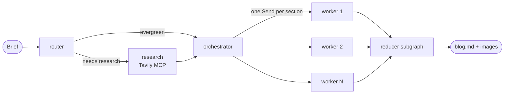

# Agentic Blog Writer

**Galley** — an agentic writing workspace that turns a one-line brief into a researched, cited, Markdown article.

A LangGraph pipeline decides whether the topic needs fresh sources, searches the web through **Tavily's MCP server**, plans the article, writes every section **in parallel** with OpenAI GPT models, optionally adds GPT-generated diagrams, and streams each step live to a Next.js frontend.

> This project is a rebuild of [AgentWriter-AI](https://github.com/entbappy/AgentWriter-AI). It keeps that project's planning-agent design and prompts, and replaces its Ollama LLM, LangChain Tavily tool, Gemini images, Postgres requirement and Jinja UI with GPT, Tavily **MCP**, GPT images, an in-memory checkpointer, a FastAPI SSE API and Next.js. See [Relationship to AgentWriter-AI](#relationship-to-agentwriter-ai).

---

## Contents

- [Features](#features)
- [How it works](#how-it-works)
- [Tavily MCP integration](#tavily-mcp-integration)
- [Relationship to AgentWriter-AI](#relationship-to-agentwriter-ai)
- [Tech stack](#tech-stack)
- [Project structure](#project-structure)
- [Getting started](#getting-started)
- [Configuration](#configuration)
- [Using the app](#using-the-app)
- [API reference](#api-reference)
- [Generated files](#generated-files)
- [Development](#development)
- [Troubleshooting](#troubleshooting)
- [Known limitations](#known-limitations)
- [License and acknowledgements](#license-and-acknowledgements)

---

## Features

- **Research only when it matters** — a router classifies each brief as `closed_book` (evergreen), `hybrid` or `open_book` (time-sensitive) and only searches the web for the last two.
- **Web research over MCP** — Tavily's hosted MCP server, called concurrently for all queries, with failed queries skipped instead of failing the run.
- **Planned, then written in parallel** — an orchestrator produces a 5–9 section outline (goal, bullets, word target per section); one GPT writer per section runs at the same time.
- **Citations from real sources** — for research topics, writers may only cite URLs that research actually returned.
- **Optional diagrams** — with `ENABLE_IMAGES=true`, up to 3 technical diagrams are planned and generated with `gpt-image-2`.
- **Live progress** — Server-Sent Events stream every stage; sections appear in the preview as each writer finishes.
- **Stop any time** — cancelling in the UI closes the stream and the backend cancels the graph run, so no tokens are spent for nobody.
- **Copy or download** — the finished article as Markdown (`.md`), with images saved alongside it.

---

## How it works



| Step | Node | What it does |
|---|---|---|
| 1 | `router` | Decides `closed_book` / `hybrid` / `open_book` and, if research is needed, writes 3–10 search queries. |
| 2 | `research` | Runs up to 10 queries on Tavily MCP (6 results each) concurrently, then GPT distils them into a deduplicated evidence list. Skipped for `closed_book`. |
| 3 | `orchestrator` | Writes the `Plan`: title, audience, tone, kind (`explainer`, `tutorial`, `news_roundup`, `comparison`, `system_design`) and 5–9 tasks. |
| 4 | `worker` × N | One per task, in parallel via LangGraph `Send`. Each writes a single `## Section` in Markdown. |
| 5 | `reducer` | A subgraph: `merge_content` orders the sections and adds the `# Title`; then either `finalize` (images off) or `decide_images` → `generate_and_place_images` (images on). Saves `blog.md`. |

The prompts for every step live in [`backend/app/graph/prompts.py`](backend/app/graph/prompts.py) and the structured outputs in [`backend/app/graph/schemas.py`](backend/app/graph/schemas.py).

---

## Tavily MCP integration

Web research goes through the **Model Context Protocol (MCP)**: instead of calling a search SDK directly, the backend connects to Tavily's MCP server, discovers the tools it offers, and calls them as LangChain tools. The integration lives in [`backend/app/tools/tavily_mcp.py`](backend/app/tools/tavily_mcp.py).

### Connection

| Setting | Value |
|---|---|
| Server | Tavily's **hosted (remote)** MCP server, `https://mcp.tavily.com/mcp/` |
| Transport | `streamable_http` |
| Client | `MultiServerMCPClient` from `langchain-mcp-adapters` (0.3.2), on top of the `mcp` SDK |
| Authentication | `Authorization: Bearer <TAVILY_API_KEY>` header |
| Key source | `TAVILY_API_KEY` in `backend/.env` |

```python
MultiServerMCPClient({
    "tavily": {
        "transport": "streamable_http",
        "url": "https://mcp.tavily.com/mcp/",
        "headers": {"Authorization": f"Bearer {settings.tavily_api_key}"},
    }
})
```

Two deliberate choices:

- **The key is sent as a header, not in the URL.** Tavily also accepts `?tavilyApiKey=…` in the URL, but URLs end up in logs; headers don't.
- **Remote HTTP instead of a local `npx` server.** The hosted server needs no Node subprocess, which avoids asyncio subprocess/event-loop problems under uvicorn on Windows.

### Tools the server exposes

Discovered with `get_tools()` at startup (5 tools):

| Tool | Required arguments | Used here |
|---|---|---|
| `tavily_search` | `query` (optional: `max_results`, `search_depth`, `topic`, `time_range`, `include_domains`, `exclude_domains`, `start_date`, `end_date`, `country`, `include_raw_content`, `include_images`, …) | **Yes** — with `query` and `max_results` |
| `tavily_extract` | `urls` | No |
| `tavily_crawl` | `url` | No |
| `tavily_map` | `url` | No |
| `tavily_research` | `input` | No |

The search tool is looked up by name and both `tavily_search` and the older `tavily-search` are accepted, because the name has changed between server versions.

### Lifecycle — how the tools reach the graph

1. **Startup** ([`main.py`](backend/app/main.py) `lifespan`): the MCP client is created and `await client.get_tools()` loads the tools **once**.
2. The tool list is passed to `build_graph(checkpointer, tools)`.
3. `make_research_node(tools)` captures the list in a closure. LangGraph only hands nodes the *state*, and live tool objects can't be stored in checkpointed state, so the closure is how the node gets them.
4. For each run, `research_node` calls `search_many(tools, queries)` → `tavily_search(...)` → `tool.ainvoke({"query": …, "max_results": 6})`.

### Search behaviour

- **Concurrent queries** — all queries run at once with `asyncio.gather` (in testing, 3 queries took about as long as 1: ~5 s).
- **Limits** — at most `MAX_QUERIES = 10` queries and `MAX_RESULTS_PER_QUERY = 6` results each ([`research.py`](backend/app/graph/nodes/research.py)).
- **Result parsing** — MCP tools return content blocks (`[{"type": "text", "text": "…"}]`). The text is parsed as JSON (`{"results": [{url, title, content, published_date}, …]}`); for older servers a `Title: / URL: / Content:` text format is also parsed. Each result is normalised to `{title, url, snippet, published_at, source}` — the same shape AgentWriter-AI used.
- **Evidence** — GPT turns the raw results into an `EvidencePack`; items are deduplicated by URL and empty URLs dropped.

### Failure handling

| Situation | What happens |
|---|---|
| `TAVILY_API_KEY` missing, or the MCP server unreachable at startup | Logged as a warning (`Tavily MCP unavailable …`); the app still starts and research returns no evidence. |
| One query fails | Logged (`Tavily search failed for …`) and skipped; the other queries still count. |
| Unreadable response (e.g. a rate-limit message) | Logged (`Unrecognised Tavily response: …`) instead of silently returning nothing. |
| No results at all | Logged; the planner works without evidence (its prompt handles "insufficient sources"). |

Every research run logs a summary such as `Tavily: 8/8 queries succeeded, 48 results`.

### Alternative: local stdio server

If you prefer running Tavily's MCP server locally (requires Node.js), replace the connection in `make_mcp_client` with:

```python
"tavily": {
    "transport": "stdio",
    "command": "npx.cmd",          # "npx" on macOS/Linux
    "args": ["-y", "tavily-mcp@latest"],
    "env": {**os.environ, "TAVILY_API_KEY": settings.tavily_api_key},  # keep PATH
}
```

On Windows, stdio servers need asyncio subprocess support, which can conflict with uvicorn's event loop — the remote server is the recommended default.

---

## Relationship to AgentWriter-AI

[AgentWriter-AI](https://github.com/entbappy/AgentWriter-AI) is the starting point. It calls Tavily through LangChain's `TavilySearchResults` tool (`langchain_community.tools.tavily_search`) — **it has no MCP integration**; MCP is new in this project.

**Kept as-is**

- The five system prompts — `ROUTER_SYSTEM`, `RESEARCH_SYSTEM`, `ORCH_SYSTEM`, `WORKER_SYSTEM`, `DECIDE_IMAGES_SYSTEM` — are identical to AgentWriter-AI's.
- The seven schemas (`Task`, `Plan`, `EvidenceItem`, `RouterDecision`, `EvidencePack`, `ImageSpec`, `GlobalImagePlan`) produce the same JSON schemas.
- The graph shape: router → research → orchestrator → parallel workers → reducer (merge → images).
- The normalised search-result shape `{title, url, snippet, published_at, source}`.

**Changed**

| Area | AgentWriter-AI | Agentic Blog Writer |
|---|---|---|
| LLM | Ollama `llama3.1:8b` (local) | OpenAI GPT via `ChatOpenAI` (`gpt-5-mini` by default) |
| Web search | `TavilySearchResults(max_results=…)`, queries run one by one | Tavily **MCP** server, queries run concurrently |
| Images | Gemini `gemini-2.5-flash-image` (`GOOGLE_API_KEY`) | OpenAI `gpt-image-2`, generated concurrently, behind `ENABLE_IMAGES` |
| Checkpointer | Postgres (`DATABASE_URL` required) | In-memory (`InMemorySaver`), no database needed |
| Execution | Synchronous nodes | Async nodes (`ainvoke`, required by MCP tools) |
| API | FastAPI serving a Jinja page, with an SSE progress stream | FastAPI JSON + SSE API (keep-alive, cancel on disconnect), CORS for the frontend |
| Frontend | Jinja + vanilla JS | Next.js 16 (App Router, React 19, Tailwind 4) |
| Packaging | `pip` + `requirements.txt` | `uv` (`pyproject.toml` + `uv.lock`) **and** a pinned `requirements.txt` |
| Output | `<title>.md` and `images/` in the working directory (plus `outputs/<run_id>/blog.md` from `app.py`) | `backend/outputs/<run_id>/blog.md` and `backend/outputs/<run_id>/images/` |

**Fixed along the way**

- **Duplicated sections** — a reducer subgraph returns its whole state, so the parent's `operator.add` on `sections` appended every section twice. The subgraph now declares an output schema (`ReducerOutput`).
- **Unsafe image file names** — model-chosen file names are reduced to a plain, unique `name.png`, so nothing like `../` can escape the run folder.
- **Lost text in image planning** — if the image planner returns noticeably less text than the article (under 90 % of its words), the article is kept unchanged and images are skipped.
- **Stray placeholders** — specs whose `[[IMAGE_n]]` placeholder isn't in the text are dropped, and leftover placeholders are removed.
- **Checkpoint safety** — `Plan`, `Task` and `EvidenceItem` are allow-listed for checkpoint deserialisation (LangGraph will block unregistered types).

---

## Tech stack

**Backend** (Python ≥ 3.13, all versions pinned)

| Package | Version | Role |
|---|---|---|
| `fastapi` | 0.162.0 | HTTP API, SSE streaming, static files |
| `uvicorn[standard]` | 0.54.0 | ASGI server |
| `langgraph` | 1.2.17 | Agent graph, parallel `Send`, checkpointing |
| `langchain-core` | 1.7.0 | Messages, tools, structured output |
| `langchain-openai` | 1.7.2 | `ChatOpenAI` |
| `openai` | 3.37.0 | Image generation |
| `langchain-mcp-adapters` | 0.3.2 | MCP client → LangChain tools |
| `pydantic` / `pydantic-settings` | 2.14.1 / 2.16.1 | Schemas and `.env` settings |

Also pinned in `requirements.txt`/`pyproject.toml` but **not imported by the app directly**: `langchain` 1.4.7, `langchain-community` 0.4.2, `tavily-python` 0.8.5, `httpx` 0.28.1, `tenacity` 9.2.1, `python-multipart` 0.0.32, `python-dotenv` 1.2.4.

**Frontend** (Node.js ≥ 20.9)

| Package | Version | Role |
|---|---|---|
| `next` | 16.4.5 | App Router (Cache Components enabled) |
| `react` / `react-dom` | 19.3.0 | UI |
| `tailwindcss` | 4 | Styling |
| `axios` | ^1.21.1 (fetch adapter) | API calls and the SSE stream |
| `react-markdown` + `remark-gfm` | 10.1.0 + 4.0.1 | Article rendering (raw HTML is **not** rendered) |

---

## Project structure

```text
agentic_blog_writer/
├── backend/
│   ├── app/
│   │   ├── main.py              # FastAPI app: lifespan (MCP tools + graph), CORS, /outputs
│   │   ├── routes.py            # /api/runs, /api/runs/stream, /api/runs/{id}/download
│   │   ├── stream.py            # graph progress -> SSE events, keep-alive, cancel on disconnect
│   │   ├── sse.py               # SSE formatting helpers
│   │   ├── config.py            # settings (.env), OUTPUTS_DIR, logging
│   │   ├── llm.py               # ChatOpenAI factory
│   │   ├── images.py            # GPT image generation
│   │   ├── tools/
│   │   │   └── tavily_mcp.py    # Tavily MCP client, search, parsing
│   │   └── graph/
│   │       ├── builder.py       # build_graph(), reducer subgraph, checkpoint serializer
│   │       ├── prompts.py       # system prompts
│   │       ├── schemas.py       # Pydantic structured outputs
│   │       ├── state.py         # State, WorkerState, ReducerOutput
│   │       └── nodes/           # router, research, orchestrator, worker, reducer
│   ├── outputs/                 # generated articles (git-ignored)
│   ├── pyproject.toml · uv.lock · requirements.txt
│   └── .env.example
└── frontend/
    ├── src/
    │   ├── app/                 # layout, page, globals.css
    │   ├── components/          # Masthead, Desk, BriefForm, StageTimeline, PlanPanel,
    │   │                        # SourcesPanel, Manuscript, MarkdownView, ArticleActions
    │   └── lib/                 # api (axios), stream (SSE reader), useRun (run state),
    │                            # types, format, useNow
    ├── package.json
    └── .env.example
```

---

## Getting started

### Prerequisites

- **Python 3.13** and **[uv](https://docs.astral.sh/uv/)** (or plain `pip`)
- **Node.js 20.9+** and npm
- An **OpenAI API key** — <https://platform.openai.com/api-keys>
- A **Tavily API key** (`tvly-…`) — <https://app.tavily.com>

### 1. Backend

```bash
cd backend
uv sync
cp .env.example .env        # Windows PowerShell: Copy-Item .env.example .env
```

Edit `backend/.env` and set at least `OPENAI_API_KEY` and `TAVILY_API_KEY`.

Start the API **from the `backend/` folder** (settings are read from `.env` in the current directory):

```bash
uv run python -m uvicorn app.main:app --reload --port 8000
```

On startup you should see:

```text
INFO    app.main: Loaded 5 Tavily MCP tools
INFO    app.main: Graph ready (model=gpt-5-mini, images=off)
```

Check it: <http://localhost:8000/api/health> → `{"status":"ok"}`. Interactive API docs: <http://localhost:8000/docs>.

<details>
<summary>Without uv (pip)</summary>

```bash
cd backend
python -m venv .venv
source .venv/bin/activate          # Windows: .venv\Scripts\Activate.ps1
pip install -r requirements.txt
python -m uvicorn app.main:app --reload --port 8000
```
</details>

### 2. Frontend

```bash
cd frontend
npm install
cp .env.example .env.local  # Windows PowerShell: Copy-Item .env.example .env.local
npm run dev
```

Open <http://localhost:3000>. The header shows **Connected** when the frontend can reach the API.

> The frontend must run on the origin in `FRONTEND_ORIGIN` (default `http://localhost:3000`), otherwise the browser blocks API calls (CORS).

---

## Configuration

### Backend — `backend/.env`

| Variable | Default | Description |
|---|---|---|
| `OPENAI_API_KEY` | — (**required**) | Used for all GPT calls and image generation. |
| `OPENAI_MODEL` | `gpt-5-mini` | Chat model for every agent. No `temperature` is sent, because GPT-5 reasoning models only accept the default. |
| `OPENAI_IMAGE_MODEL` | `gpt-image-2` | Image model (`gpt-image-1` is retired for generation). |
| `TAVILY_API_KEY` | — (**required for research**) | Sent to the Tavily MCP server as a Bearer token. |
| `ENABLE_IMAGES` | `false` | `true` adds the image planning + generation steps. |
| `FRONTEND_ORIGIN` | `http://localhost:3000` | The single origin allowed by CORS. |
| `LOG_LEVEL` | `INFO` | `DEBUG`, `INFO`, `WARNING` or `ERROR`; any other value fails at startup. |

### Frontend — `frontend/.env.local`

| Variable | Default | Description |
|---|---|---|
| `NEXT_PUBLIC_API_URL` | `http://localhost:8000` | Backend base URL. Inlined at build time, so rebuild after changing it. |

---

## Using the app

1. **Write a brief** — a topic, question or idea (3–1,000 characters). Optionally pick an **Industry** and **Audience**; they're appended to the brief (`Industry: …`, `Write for …`) and count toward the 1,000-character limit. Or start from one of the suggestions.
2. **Generate article** (or **Ctrl/⌘ + Enter**).
3. **Follow the progress** — *Understand the brief → Find reliable sources → Build the outline → Write the sections → Finish the article*, with a running clock. The contents list fills in as sections are written, and research sources are listed with their domain and date.
4. **Watch the preview** — the outline appears first, then each section as soon as its writer finishes, then the finished article.
5. **Copy markdown** (image links are made absolute) or **Download .md**.
6. **Stop generation** at any point; the notice shows how much was written before it stopped.

A typical evergreen article takes about 1 minute; a research article about 2–3 minutes. Enabling images adds roughly 3–4 minutes (most of it in image planning — see [Known limitations](#known-limitations)).

---

## API reference

| Method | Path | Description |
|---|---|---|
| `GET` | `/api/health` | `{"status": "ok"}` |
| `POST` | `/api/runs` | Body `{"topic": "…"}`. Runs the whole graph and returns `{"run_id", "markdown"}` (useful from `/docs`). |
| `POST` | `/api/runs/stream` | Body `{"topic": "…"}`. Streams progress as **Server-Sent Events**. |
| `GET` | `/api/runs/{run_id}/download` | The saved `blog.md` as an attachment named after the title. `422` for a non-UUID id, `404` if not found. |
| `GET` | `/outputs/{run_id}/images/{file}` | Generated images. |

`topic` is trimmed and must be 3–1,000 characters (`422` otherwise).

### Streaming

```bash
curl -N -X POST http://localhost:8000/api/runs/stream \
  -H "Content-Type: application/json" \
  -d '{"topic": "Explain self-attention"}'
```

Each event is one `data: {json}` line followed by a blank line. While nothing happens for 15 s, the server sends a `: keep-alive` comment. If the client disconnects, the run is cancelled.

| `type` | Fields | When |
|---|---|---|
| `run_started` | `run_id`, `topic` | First event |
| `stage` | `id` (`router`, `research`, `orchestrator`, `workers`, `reducer`), `status` (`running`, `done`, `skipped`), optional `total`, `detail` | Each stage change |
| `route` | `mode`, `needs_research`, `queries` | After the router |
| `sources` | `evidence` | After research |
| `plan` | `plan` | After the orchestrator |
| `section_done` | `task_id`, `title`, `markdown`, `done`, `total` | As each writer finishes |
| `images_planned` | `count` | Images on only |
| `final` | `run_id`, `markdown`, `download_url` | Last event on success |
| `error` | `run_id`, `message` | Last event on failure |

In `final.markdown`, image links point to `/outputs/<run_id>/images/…`; the saved `blog.md` keeps relative `images/…` links so it renders on its own.

---

## Generated files

```text
backend/outputs/<run_id>/
├── blog.md
└── images/            # only when ENABLE_IMAGES=true
    ├── qkv_flow.png
    └── …
```

`run_id` is a UUID. The folder is git-ignored and is not cleaned up automatically.

---

## Development

```bash
# frontend
cd frontend
npx tsc --noEmit     # type-check
npm run lint         # ESLint
npm run build        # production build
```

- **Logging** — every backend module logs under the `app` logger (`get_logger(__name__)` in [`config.py`](backend/app/config.py)), one line per step, e.g. `Router: mode=open_book, research=True, 8 queries` and `Section 3 done: '…' (412/400 words)`.
- **Dependencies** — after `uv add --bounds exact <pkg>`, add the same pinned line to `backend/requirements.txt` so both stay in sync.
- **Tests** — there is no automated test suite yet.

---

## Troubleshooting

| Problem | Fix |
|---|---|
| `Failed to spawn: uvicorn … An Application Control policy has blocked this file` (Windows Smart App Control) | Start the server through Python instead of the `uvicorn.exe` launcher: `uv run python -m uvicorn app.main:app --port 8000`. |
| `DLL load failed … Application Control policy has blocked this file` | Smart App Control is blocking a compiled file. Use a python.org Python install (the project pins 3.13 and prefers system Pythons), or run the backend in WSL/Docker. |
| Header says **Service unavailable** | The backend isn't running, or `NEXT_PUBLIC_API_URL` points elsewhere. |
| Browser console shows a CORS error | The frontend isn't on `FRONTEND_ORIGIN` (e.g. Next picked port 3001). Free port 3000 or change `FRONTEND_ORIGIN`. |
| `Tavily MCP unavailable` at startup | Check `TAVILY_API_KEY` and network access to `mcp.tavily.com`. The app runs without research meanwhile. |
| `The model 'gpt-image-1' does not exist` | Use `OPENAI_IMAGE_MODEL=gpt-image-2`. |
| `OPENAI_API_KEY is missing` | Set it in `backend/.env` and start the server from `backend/`. |
| `404 model_not_found` / `429 insufficient_quota` | Choose a model your account can use (`OPENAI_MODEL`), or add credit. |

---

## Known limitations

- **No persistence across restarts** — runs are checkpointed in memory only; generated files in `outputs/` remain.
- **Image planning is slow** — `decide_images` asks GPT to re-emit the whole article with placeholders (~100 s for a 3,000-word article).
- **Router queries** — the copied router prompt often produces Google-style operators (`site:`, `after:`, `OR`), which Tavily handles only partly.
- **Writers sometimes echo their brief** (e.g. a leading `Goal: …` line).
- **Single CORS origin**, no authentication and no run history endpoint.
- **Cost** — every run makes N + 2 GPT calls (router, orchestrator and N section writers; N is typically 5–9), plus one more for research topics and one more when images are on. Research topics also make up to 10 Tavily searches, and images add up to 3 image generations.

---

## License and acknowledgements

This repository does not include a license file yet. It builds on [AgentWriter-AI](https://github.com/entbappy/AgentWriter-AI), whose `LICENSE` file is the **Apache License 2.0** (its README says MIT, but the license file is what applies). The prompts and schemas here are derived from it, so if you redistribute this project, include a copy of the Apache 2.0 license and state that those files were changed.

Built with [LangGraph](https://github.com/langchain-ai/langgraph), [LangChain](https://github.com/langchain-ai/langchain), [langchain-mcp-adapters](https://github.com/langchain-ai/langchain-mcp-adapters), [Tavily](https://tavily.com), [OpenAI](https://platform.openai.com), [FastAPI](https://fastapi.tiangolo.com) and [Next.js](https://nextjs.org).
