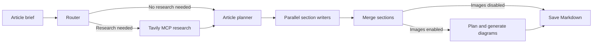

# Galley - Agentic Blog Writer

Galley is a writing workspace that turns a brief into a researched Markdown article. A Next.js frontend displays live progress while a FastAPI backend runs a LangGraph pipeline for research, planning, and section writing.

## Features

- Classifies topics to decide whether web research is needed.
- Finds sources through Tavily's hosted Model Context Protocol (MCP) server.
- Creates an article outline and writes sections in parallel with OpenAI models.
- Uses research evidence to support source citations.
- Optionally generates and inserts up to three diagrams.
- Streams progress, sources, outlines, and completed sections to the frontend.
- Supports stopping generation, copying Markdown, and downloading the article.
- Includes light and dark themes with a saved preference and system-theme default.

## Tech stack

| Area | Technologies |
|---|---|
| Frontend | Next.js 16, React 19, TypeScript, Tailwind CSS 4 |
| Article rendering | react-markdown, remark-gfm |
| API communication | Axios with the fetch adapter, Server-Sent Events (SSE) |
| Backend | Python 3.13+, FastAPI, Uvicorn, Pydantic |
| Workflow | LangGraph, LangChain, OpenAI |
| Research | Tavily MCP, langchain-mcp-adapters |
| Dependency management | uv or pip for the backend; npm for the frontend |

Exact dependencies are listed in [backend/pyproject.toml](backend/pyproject.toml), [backend/requirements.txt](backend/requirements.txt), and [frontend/package.json](frontend/package.json).

## How it works



1. **Router:** classifies the brief as `closed_book`, `hybrid`, or `open_book` and proposes research queries when needed.
2. **Research:** runs searches concurrently through Tavily MCP and creates a deduplicated evidence list.
3. **Planner:** defines the title, audience, tone, article type, and section tasks.
4. **Writers:** draft individual sections in parallel.
5. **Reducer:** orders and merges the sections, optionally inserts generated images, and saves the article.

The frontend receives SSE events throughout the run. Prompts are in [backend/app/graph/prompts.py](backend/app/graph/prompts.py), and structured output models are in [backend/app/graph/schemas.py](backend/app/graph/schemas.py).

## Project structure

```text
agentic_blog_writer/
|-- backend/
|   |-- app/
|   |   |-- main.py          # API startup, CORS, static outputs
|   |   |-- routes.py        # Run and download endpoints
|   |   |-- stream.py        # Workflow progress streaming
|   |   |-- sse.py           # SSE formatting
|   |   |-- config.py        # Environment settings and logging
|   |   |-- llm.py           # Chat model configuration
|   |   |-- images.py        # Image generation
|   |   |-- tools/          # Tavily MCP integration
|   |   `-- graph/          # Graph builder, prompts, schemas, nodes
|   |-- outputs/            # Generated articles and images (ignored by Git)
|   |-- .env.example
|   |-- pyproject.toml
|   |-- requirements.txt
|   `-- uv.lock
|-- frontend/
|   |-- src/
|   |   |-- app/            # Root layout, homepage, shared styles
|   |   |-- components/     # Workspace panels, preview, theme toggle
|   |   `-- lib/            # API client, SSE reader, hooks, types
|   |-- .env.example
|   `-- package.json
`-- README.md
```

## Getting started

### Prerequisites

- Python 3.13 or later.
- uv, or pip with a Python virtual environment.
- Node.js 20.9 or later and npm.
- An OpenAI API key for article and optional image generation.
- A Tavily API key for web research.

### 1. Start the backend

From the repository root:

```sh
cd backend
uv sync
```

Copy `backend/.env.example` to `backend/.env`:

```powershell
Copy-Item .env.example .env
```

On macOS or Linux, use `cp .env.example .env` instead. Set `OPENAI_API_KEY` and `TAVILY_API_KEY` in the copied file.

Start the backend from the `backend` directory so its `.env` file is loaded:

```sh
uv run python -m uvicorn app.main:app --reload --port 8000
```

- Health endpoint: <http://localhost:8000/api/health>
- Interactive API documentation: <http://localhost:8000/docs>

To use pip instead of uv, create and activate a virtual environment, run `pip install -r requirements.txt`, then start the server with `python -m uvicorn app.main:app --reload --port 8000`.

### 2. Start the frontend

In a separate terminal, from the repository root:

```sh
cd frontend
npm ci
```

Copy `frontend/.env.example` to `frontend/.env.local`:

```powershell
Copy-Item .env.example .env.local
```

On macOS or Linux, use `cp .env.example .env.local` instead.

```sh
npm run dev
```

Open <http://localhost:3000>. The header shows **Connected** when the frontend can reach the backend.

On Windows, if PowerShell blocks npm scripts, use `npm.cmd` and `npx.cmd` in place of `npm` and `npx`.

## Configuration

### Backend: `backend/.env`

| Variable | Default | Purpose |
|---|---|---|
| `OPENAI_API_KEY` | Empty | API key for chat and image generation. |
| `OPENAI_MODEL` | `gpt-5-mini` | Chat model used by the writing pipeline. |
| `OPENAI_IMAGE_MODEL` | `gpt-image-2` | Model used for optional diagrams. |
| `TAVILY_API_KEY` | Empty | API key for Tavily MCP research. |
| `ENABLE_IMAGES` | `false` | Enables image planning and generation when set to `true`. |
| `FRONTEND_ORIGIN` | `http://localhost:3000` | Frontend origin allowed by CORS. |
| `LOG_LEVEL` | `INFO` | One of `DEBUG`, `INFO`, `WARNING`, or `ERROR`. |

These defaults come from [backend/app/config.py](backend/app/config.py). Restart the backend after changing its configuration.

### Frontend: `frontend/.env.local`

| Variable | Default | Purpose |
|---|---|---|
| `NEXT_PUBLIC_API_URL` | `http://localhost:8000` | Backend base URL used by the browser. |

Restart the development server after changing the frontend environment. For production, rebuild the frontend because public environment variables are included at build time.

### Theme preference

Use the **Dark mode** or **Light mode** button in the header to switch themes. The selection is stored in browser local storage under `galley-theme` and synchronized across tabs. Without a saved selection, the app follows the system color preference. The initial theme is applied before page content is painted.

## Using the workspace

1. Enter a topic, question, or article brief.
2. Optionally select an industry and audience. The combined brief must fit within 1,000 characters, and the topic must contain at least three characters.
3. Select **Generate article**, or press **Ctrl+Enter** / **Cmd+Enter**.
4. Follow the pipeline progress, review sources and the outline, and watch sections appear in the preview.
5. Use **Copy markdown** or **Download .md** when the article is ready.
6. Select **Stop generation** to cancel an active run.

## API reference

| Method | Endpoint | Description |
|---|---|---|
| `GET` | `/api/health` | Returns `{"status":"ok"}`. |
| `POST` | `/api/runs` | Runs the workflow and returns `run_id` and `markdown`. |
| `POST` | `/api/runs/stream` | Streams workflow progress as SSE. |
| `GET` | `/api/runs/{run_id}/download` | Downloads the saved Markdown article. |
| `GET` | `/outputs/{run_id}/images/{filename}` | Serves a generated image. |

Both POST endpoints accept a JSON body with a `topic` string. Leading and trailing whitespace is removed, and the topic must be 3-1,000 characters long.

Example request body:

```json
{
  "topic": "Explain self-attention for software developers"
}
```

Streaming events include `run_started`, `stage`, `route`, `sources`, `plan`, `section_done`, `images_planned`, `final`, and `error`. The stream sends keep-alive comments during idle periods. Disconnecting the streaming client cancels its run.

## Generated files

```text
backend/outputs/<run_id>/
|-- blog.md
`-- images/        # Present when images are generated
```

Each run uses a UUID. Saved Markdown uses relative image paths; Markdown returned by the API uses paths under `/outputs/<run_id>/images/`. Downloaded Markdown does not bundle the images, so keep the corresponding `images` directory alongside the file when sharing it offline.

Output files are ignored by Git and are not automatically deleted.

## Development

Run frontend checks from `frontend`:

```sh
npm run lint
npx tsc --noEmit
npm run build
```

Start a production frontend build with `npm run start` after building. Keep the backend running separately.

- Workflow definitions: [backend/app/graph/builder.py](backend/app/graph/builder.py).
- Research integration: [backend/app/tools/tavily_mcp.py](backend/app/tools/tavily_mcp.py).
- API streaming: [backend/app/stream.py](backend/app/stream.py).
- Frontend API configuration: [frontend/src/lib/api.ts](frontend/src/lib/api.ts).
- Theme control: [frontend/src/components/ThemeToggle.tsx](frontend/src/components/ThemeToggle.tsx).
- Shared colors and styles: [frontend/src/app/globals.css](frontend/src/app/globals.css).

## Troubleshooting

| Problem | What to check |
|---|---|
| Header shows **Service unavailable** | Confirm the backend is running and `NEXT_PUBLIC_API_URL` points to it. |
| Browser reports a CORS error | Match `FRONTEND_ORIGIN` to the frontend's actual origin, including the port. |
| OpenAI calls fail | Check `OPENAI_API_KEY`, account quota, and access to the configured model. |
| `Tavily MCP unavailable` appears in logs | Check `TAVILY_API_KEY` and connectivity to `mcp.tavily.com`. The app can start without research tools. |
| Settings are not loaded | Start the API from `backend` and confirm the settings are in `backend/.env`. |
| Images do not appear | Check `ENABLE_IMAGES`, the configured image model, and backend logs. |
| Windows blocks the Uvicorn launcher | Start it through Python: `uv run python -m uvicorn app.main:app --port 8000`. |

## Current limitations

- Workflow checkpoints are stored in memory and do not survive backend restarts. Generated files remain on disk.
- The application has no authentication or run history endpoint.
- CORS allows one configured frontend origin.
- Image planning and generation increase processing time and API usage.
- Research availability depends on Tavily connectivity and credentials.
- Generated articles and citations should be reviewed before publishing.
